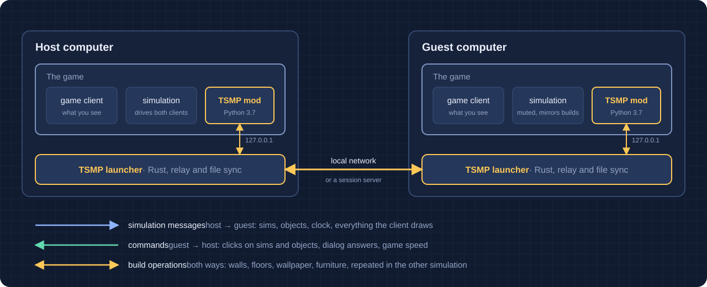

  

  <b>English</b> | <a href="README.ru.md">Русский</a>

  
  
  
  

# TSMP

Open-source multiplayer for The Sims 4. Two people play the same household on
the same lot, on one local network or over the internet, and the launcher does
the setup: it finds the other computer, copies the mods and the save, and
starts both games with the packs both players own.

## What works

  

Tried with two computers and two copies of the game:

- **Live mode.** Both players see the same lot, sims and clock. Each controls
  sims; the host's simulation decides what happens.
- **Build mode, both at once.** Walls, floors and wall coverings drawn by
  either player appear for the other while they keep building.
- **Different packs.** Players with different DLC play with the packs they
  have in common, through the game's own `-disablepacks:` option. TSMP does
  not unlock content.
- **One-button setup.** The guest's Mods folder and the shared save are made
  the same as the host's. Nothing is deleted: replaced files go to a backup
  folder.
- **One log for both games.** Each mod sends its log lines to the other side,
  and the launcher shows the latest ones under the session status.

The guest loads the host's world when it arrives, and again whenever the two
could have drifted apart: the host's lot was loaded again (after Create-a-Sim
or travel), the guest's own was, or the connection dropped. Meanwhile the
host's game stays paused, and both players are told what is going on. A
dropped connection is noticed within seconds and the session picks up again
by itself, on a LAN or over the internet. Players can be on different lots,
each playing their own. A guest can also come with a household made in a save
of their own: it is copied into the host's save, and the guest keeps playing
it there; the host picks "Each with their own family" in the launcher for
that, and then no save is copied, but both launchers back up their saves.
All of this is new and not yet proven in two games.

Not handled yet: Create-a-Sim with two players (the guest waits while the
host is in it, and cannot open it for its own sim). In build mode, furniture
and household funds have not been checked for double counting.

## How it works

  

The game is already split into a client and a simulation that exchange
messages. The TSMP mod sits on that boundary. On the host it copies what the
simulation tells the client and sends it to the guest, whose client draws it.
What the guest clicks is sent back and run by the host's simulation.

Build mode does not pass through the game's Python, so the mod records each
build operation where the client hands it to the simulation and repeats it in
the other game. The addresses this needs differ between game builds; on a
build the mod does not know, that part switches itself off and the rest keeps
working.

The mod itself is thin. Discovery, file transfer and the link between the two
computers live in the launcher. [docs/internals.md](docs/internals.md) has the
details and how each of them was found.

## Playing

<table>
  <tr>
    <td width="50%"></td>
    <td width="50%"></td>
  </tr>
  <tr>
    <td valign="top"><b>One of you hosts.</b> Your save and your mods become the shared ones. You open the door.</td>
    <td valign="top"><b>The other joins.</b> The launcher finds the host at home and copies what is needed. You walk in.</td>
  </tr>
</table>

You need two Windows computers, each with its own copy of the game at the
same version, and script mods enabled in the game options. On one local
network that is all; from different networks you also need a session server
(see [Playing over the internet](#playing-over-the-internet)).

1. Build the launcher and the mod (see [Building](#building)), or take them
   from someone who has. Copy `tsmp.ts4script` into the `Mods` folder of the
   host. Remove other multiplayer mods first; they patch the same functions.
2. Both players run `tsmp.exe`. Windows asks once to allow it through the
   firewall: allow it on private networks, or the host will not be found.
3. One player chooses **Host a session** and picks the save to share.
4. The other chooses **Join a session**, picks the host from the list, reads
   what will change and presses **Sync**.
5. Both press **Start game** and load the shared save.
6. The guest loads the host's world once more after its lot loads; the host's
   game stays paused until the launcher says **Live. Both games are joined.**

Keep the launcher open while playing; it carries the session.

> [!WARNING]
> Joining runs the host's script mods on your computer. Script mods are
> unrestricted code. Only join people you trust.

Good to know:

- Files the host lacks, and local versions that differ, are moved to
  `Mods.tsmp-backup/<date>/` next to the Mods folder. Saves go to
  `saves.tsmp-backup/` the same way.
- A Steam copy is started through Steam, which may ask to confirm the launch
  arguments.
- After the game starts, the launcher reads the mod's report and warns if the
  game loaded packs the session should not have.
- `tsmp.status` in the cheat console shows the state of the session from
  inside the game. `<user dir>/tsmp/tsmp.log` records what happened in both
  games.
- Build mode sync is on by default. To switch it off, put
  `{"native": false}` in `<user dir>/tsmp/config.json`.
- For testing without a player at the keyboard, `{"driver": true}` in the
  same file makes the mod run every line written to `<user dir>/tsmp/run.txt`
  as a console command. `tsmp.selftest` writes what the game holds (lot,
  households, sims, clock) to the log, so two games can be compared there.

### Playing over the internet

Two computers on different networks usually cannot reach each other, so they
meet on a TSMP session server that both can reach: one that a friend runs, or
your own (see [Running a session server](#running-a-session-server)).

1. The host opens the session as usual. Under **Over the internet** on the
   session screen they enter the server's address and press **Open**. The
   launcher shows an invite such as `K7QM-2XDA@play.example.org` with a
   button that copies it.
2. The host sends the invite to the other player.
3. The other player chooses **Join a session**, pastes the invite where the
   host's address goes and presses **Connect**. From here everything is as on
   a local network.

The server only passes bytes between the two launchers; the files and the
game travel through it, so its connection decides how fast the guest syncs.
The invite stays the same if the host's connection to the server drops for a
moment; it ends when the host closes it, stops hosting, or has been away for
two minutes. The launcher remembers the server for next time; the variable
`TSMP_SERVER` sets it in advance.

### Running a session server

`tsmp-server` is a small program without settings files that keeps nothing on
disk. Any computer that both players can reach will do, typically a cheap
Linux server with a public address. It needs one TCP port open, 47810 by
default.

    cargo build --release -p tsmp-server    # -> target/release/tsmp-server
    ./tsmp-server --listen 0.0.0.0:47810

`tsmp-server --help` lists the limits that can be changed: sessions at once,
connections in all and from one address, how often hosts are pinged and how
long a session waits for a host that lost its connection. The server writes
one line to standard error for every session opened, resumed, lost and
closed, and how busy it is once an hour.

Under systemd, `/etc/systemd/system/tsmp-server.service`:

    [Unit]
    Description=TSMP session server
    After=network-online.target

    [Service]
    ExecStart=/usr/local/bin/tsmp-server
    DynamicUser=yes
    Restart=always

    [Install]
    WantedBy=multi-user.target

A session code is eight characters, and an address that asks for codes that
do not exist is held back for a minute after twenty, so codes cannot be
found by guessing. Anyone who has an invite can join that session, the same
as anyone on the host's local network can: send it only to the person you
are playing with.

## Game versions and branches

Each branch of this repository is named after the game version it was built
and tried against. The current one is **`1.129.39.1030`**.

A game update does not get a new branch by itself. A new branch is started
only when an update breaks the mod; until then the current branch is the one
to use. The part most likely to break is build mode sync, because it depends
on addresses inside `Simulation_x64.dll`. The mod checks the build before it
touches anything and leaves an unknown one alone.

Those addresses are data, not code: one file per game version in
[`mappings/`](mappings). The launcher carries the files known when it was
built. When the installed game is a version it has no file for, it asks this
repository for `mappings/<version>.json`, so a game update whose addresses
have been found needs a new file here and nothing else. The home screen says
whether building together is ready for the installed version. A file names
the build it describes and the function each hooked slot must point to, and
the mod compares both with the running game before it uses anything.

## Updates

When it starts, the launcher asks GitHub for the latest release of this
repository. A newer `tsmp.exe` is downloaded, checked against the checksum
GitHub publishes for it and put in place of the running file; the top bar
then offers to restart. The mod is inside the launcher, so it is updated by
the same step. The requests carry the program's name and version and nothing
about you or your computer. Set the environment variable `TSMP_NO_UPDATE` to
switch this off.

A release is made by pushing a tag `v<version>` that matches the version in
`crates/tsmp-launcher/Cargo.toml`; `.github/workflows/release.yml` builds and
publishes it.

## Building

    cargo test                               # everything except the UI itself
    cargo build --release -p tsmp-launcher   # -> target/release/tsmp.exe
    cargo run -p tsmp-cli -- info            # show the detected game and packs
    cargo build -p tsmp-server --example live_pair   # lets the mod tests use the real relay and server
    cargo build --release -p tsmp-server     # -> target/release/tsmp-server
    python -m unittest discover -s mod/tests
    python mod/build.py                      # -> dist/tsmp.ts4script

`mod/build.py` needs a Python 3.7 interpreter, because the game only loads
3.7 bytecode. Unpack the official embeddable Python 3.7 zip into
`.tools/python37/`, or pass `--python37 <exe>`.

## What is in the repository

| Path | What it is |
| --- | --- |
| `mod/` | The script mod (Python 3.7): hooks, the link to the launcher, session rules, build mode sync |
| `crates/tsmp-core` | Finds the game, works out the packs two players share, builds and compares manifests of a Mods folder |
| `crates/tsmp-net` | LAN discovery, the launcher-to-launcher protocol for mods and saves, the relay between the two games, meeting through a session server |
| `crates/tsmp-server` | The session server for players on different networks |
| `crates/tsmp-launcher` | The launcher (Rust + [gpui](https://www.gpui.rs)) |
| `crates/tsmp-cli` | A diagnostic command line over the core |
| `mappings/` | Addresses inside the game's simulation library, one file per game version |
| `docs/internals.md` | What is known about the game's internals and how it was learned |

## Translations

The launcher speaks Deutsch, English, Español, Français, Italiano, Polski,
Português (Brasil), Русский, Українська and 简体中文. It starts in the system
language and remembers the one picked from the list in the top bar.

Each language is one [Fluent](https://projectfluent.org) file in
`crates/tsmp-launcher/locales/`, named by its language code (`de.ftl`,
`pt-BR.ftl`). They are built into the exe, and nothing else lists them: adding
a file adds the language.

To add or fix a translation:

1. Copy `en.ftl` to `<code>.ftl` and translate the text after each `=`. Keep
   the message names and the `{ $variables }` as they are. `language-name` is
   the language's own name, as shown in the list.
2. Give counted messages the plural forms the language has (see `ru.ftl` for
   one with three).
3. Run `cargo test -p tsmp-launcher`. It fails if a message or variable is
   missing or a message cannot be formatted.

To try a file without rebuilding, put it in a `locales` folder next to
`tsmp.exe`; files there replace the built-in ones. A message missing from a
language is shown in English.

Most translations have not yet been checked by native speakers, and the
game's own menu names in them may differ from what the game shows.
Corrections are welcome.

## Contributing

Issues and pull requests are welcome. Two rules keep the project safe to
publish:

- No code or assets of the game in the repository. Findings about the game go
  into `docs/internals.md` as descriptions, with how to reproduce them.
- Nothing that unlocks content a player does not own.

## Licence

[MIT](LICENSE). Not affiliated with or endorsed by Electronic Arts. The Sims
is a trademark of Electronic Arts Inc.

The launcher embeds the Golos Text and Unbounded typefaces under the SIL Open
Font License; the licence texts are in `crates/tsmp-launcher/assets/fonts/`.
