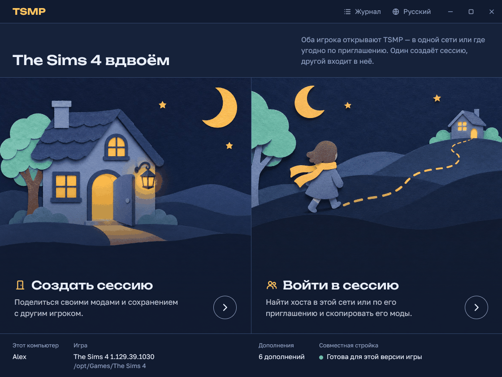
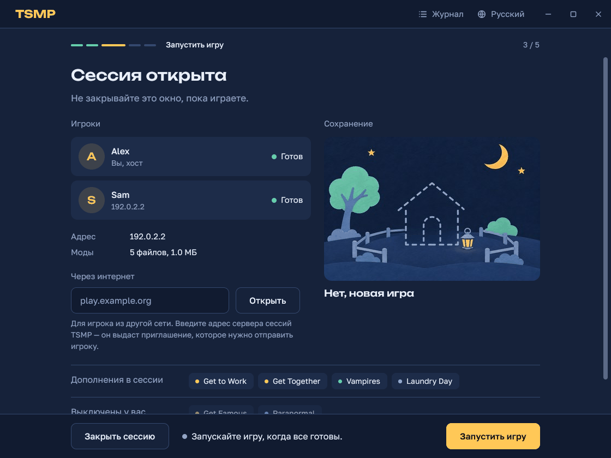
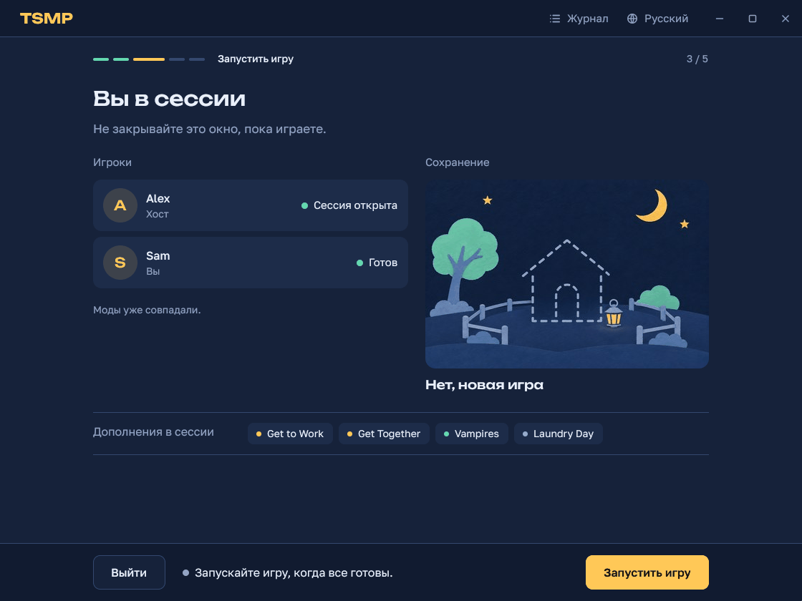

  

  <a href="README.md">English</a> | <b>Русский</b>

  
  
  
  
  
  
  

# TSMP — мультиплеер для The Sims 4

Бесплатный мультиплеер с открытым кодом для The Sims 4. С ним можно играть
вдвоём в одном мире — по локальной сети или через интернет, — а настройку
берёт на себя лаунчер: находит второй компьютер, копирует моды и сохранение и
запускает обе игры с теми дополнениями, которые есть у обоих.

   
  <a href="https://github.com/Rxflex/TSMP/releases">Все выпуски</a>

  Один файл для Windows, мод уже внутри. Каждому игроку нужен свой компьютер
  и своя копия The Sims 4, причём одной и той же версии. 
  Проект экспериментальный: что и как уже проверено, написано в разделе <a href="#что-работает">«Что работает»</a>.

  <a href="#как-играть">Как играть</a> ·
  <a href="#игра-через-интернет">Через интернет</a> ·
  <a href="#каждый-со-своей-семьёй">Свои семьи</a> ·
  <a href="#свой-сервер-сессий">Сервер сессий</a> ·
  <a href="#вопросы-и-ответы">Вопросы и ответы</a> ·
  <a href="#сборка">Сборка</a> ·
  <a href="docs/internals.md">Как это устроено внутри</a>

  

## Что работает

  

<table>
  <tr>
    <td width="50%" valign="top"><b>🏠 Режим жизни</b> Оба игрока видят один участок, одних симов и одни часы. Каждый управляет своими симами, а что произойдёт, решает симуляция хоста.</td>
    <td width="50%" valign="top"><b>🧱 Строительство вдвоём</b> Стены, полы и покрытия стен, которые рисует один игрок, появляются у второго, пока тот тоже строит.</td>
  </tr>
  <tr>
    <td valign="top"><b>🌍 Через интернет</b> Игроки из разных сетей встречаются на небольшом сервере сессий по приглашению вида <code>K7QM-2XDA@play.example.org</code>. После обрыва связи сессия продолжается сама.</td>
    <td valign="top"><b>👨‍👩‍👧 Каждый со своей семьёй</b> Гость приводит семью из своего сохранения, вместе с её отношениями, в мир хоста и продолжает играть ею там.</td>
  </tr>
  <tr>
    <td valign="top"><b>🎨 Редактор персонажа</b> Каждый меняет своих симов, и игра хоста получает новую внешность сима гостя.</td>
    <td valign="top"><b>🧭 Разные участки</b> Игроки могут быть каждый на своём участке и снова встречаться; гость, едущий к хосту, видит один экран загрузки.</td>
  </tr>
  <tr>
    <td valign="top"><b>📦 Разные дополнения</b> Игроки с разным набором DLC играют с общими для них дополнениями через штатный параметр игры <code>-disablepacks:</code>. TSMP ничего не разблокирует.</td>
    <td valign="top"><b>⚙️ Настройка одной кнопкой</b> Папка Mods и общее сохранение гостя становятся такими же, как у хоста. Ничего не удаляется: заменённые файлы уходят в резервную копию.</td>
  </tr>
</table>

**Проверено на двух компьютерах с двумя копиями игры:** режим жизни,
строительство вдвоём, разные дополнения, настройка одной кнопкой в локальной
сети и один журнал на две игры (каждый мод отправляет строки своего журнала
второй стороне, а лаунчер показывает последние под статусом сессии).

**Новое, пока проверено только в тестах против протокола игры:** игра через
интернет, свои семьи, редактор персонажа для гостя, разные участки и то, как
сессия сама держит обе игры в одном состоянии. Гость загружает мир хоста,
когда приходит, и снова всякий раз, когда игры могли разойтись (участок
загрузился заново, оборвалась связь); всё это время игра хоста стоит на паузе,
а оба игрока видят, что происходит. Фазз-тест прогоняет хоста и гостя через
десятки тысяч случайных цепочек перезагрузок, переездов, обрывов связи и
сбоев, чтобы это оставалось правдой.

Пока не сделано: гость ждёт, пока хост в редакторе персонажа. Если оба строят
на одном участке, элемент, который оба меняют в одно и то же мгновение, может
получиться разным в двух играх. В режиме строительства мебель и деньги семьи
ещё не проверены на двойной учёт.

## Как это устроено

  

Игра уже разделена на клиент и симуляцию, которые обмениваются сообщениями.
Мод TSMP стоит на этой границе. У хоста он копирует то, что симуляция
сообщает клиенту, и отправляет гостю, а клиент гостя это рисует. То, что
нажимает гость, уходит обратно и выполняется симуляцией хоста.

Режим строительства не проходит через Python игры, поэтому мод записывает
каждую строительную операцию там, где клиент передаёт её симуляции, и
повторяет её во второй игре. Нужные для этого адреса меняются от сборки к
сборке; на незнакомой сборке эта часть сама отключается, а остальное
продолжает работать.

Сам мод тонкий. Поиск в сети, передача файлов и связь между компьютерами
живут в лаунчере. Подробности и то, как каждая из них была найдена, описаны в
[docs/internals.md](docs/internals.md) (на английском).

## Как играть

<table>
  <tr>
    <td width="50%"></td>
    <td width="50%"></td>
  </tr>
  <tr>
    <td valign="top"><b>Один из вас — хост.</b> Его сохранение и его моды становятся общими. Он открывает дверь.</td>
    <td valign="top"><b>Второй подключается.</b> Лаунчер сам находит хоста в домашней сети и копирует всё нужное. Он заходит в гости.</td>
  </tr>
</table>

Нужны два компьютера с Windows, на каждом своя копия игры одной и той же
версии, и в настройках игры должны быть включены скриптовые моды. В одной
локальной сети этого достаточно; из разных сетей нужен ещё сервер сессий
(см. [Игра через интернет](#игра-через-интернет)).

1. Оба игрока скачивают
   [`tsmp.exe`](https://github.com/Rxflex/TSMP/releases/latest/download/tsmp.exe)
   со страницы [выпусков](https://github.com/Rxflex/TSMP/releases) или
   собирают его сами (см. [Сборка](#сборка)). Мод уже внутри: лаунчер кладёт
   его в папку `Mods` хоста, когда тот создаёт сессию, а гость получает его при
   синхронизации. Другие моды для мультиплеера меняют те же функции, поэтому
   найденные файлы S4MP лаунчер убирает в резервную копию; любой другой такой
   мод уберите заранее сами.
2. Оба игрока запускают `tsmp.exe`. У него нет цифровой подписи, поэтому при
   первом запуске Windows может показать «Система Windows защитила ваш
   компьютер»: нажмите **Подробнее**, затем **Выполнить в любом случае**.
   Потом Windows один раз спросит, разрешить ли `tsmp.exe` доступ через
   брандмауэр: разрешите для частных сетей, иначе хост не будет найден.
3. Один игрок выбирает **Создать сессию** и сохранение, которым поделится.
4. Второй выбирает **Войти в сессию**, находит хоста в списке, читает, что
   изменится, и нажимает **Синхронизировать**.
5. Оба нажимают **Запустить игру** и загружают общее сохранение.
6. Когда участок загрузится, гость ещё раз загружает мир хоста; игра хоста
   стоит на паузе, пока лаунчер не напишет **Сессия идёт. Обе игры
   соединены.**

<table>
  <tr>
    <td width="50%"></td>
    <td width="50%"></td>
  </tr>
  <tr>
    <td valign="top"><b>Хост</b> видит, что оба готовы, и какие дополнения есть у обоих.</td>
    <td valign="top"><b>Гость</b> в сессии: осталось запустить игру.</td>
  </tr>
</table>

Не закрывайте лаунчер во время игры: сессия идёт через него.

> [!WARNING]
> При подключении скриптовые моды хоста запускаются на вашем компьютере.
> Скриптовый мод может делать что угодно. Подключайтесь только к тем, кому
> доверяете.

Полезно знать:

- Файлы, которых нет у хоста, и ваши версии, которые отличаются, переносятся
  в `Mods.tsmp-backup/<дата>/` рядом с папкой Mods. Сохранения так же уходят
  в `saves.tsmp-backup/`.
- Копия из Steam запускается через Steam, и он может попросить подтвердить
  параметры запуска.
- После запуска игры лаунчер читает отчёт мода и предупреждает, если игра
  загрузила дополнения, которых в сессии быть не должно.
- `tsmp.status` в консоли читов показывает состояние сессии изнутри игры.
  В `<папка пользователя>/tsmp/tsmp.log` записано, что происходило в обеих
  играх.
- Синхронизация строительства включена по умолчанию. Чтобы выключить её,
  запишите `{"native": false}` в `<папка пользователя>/tsmp/config.json`.
- Для проверок без игрока за клавиатурой `{"driver": true}` в том же файле
  заставляет мод выполнять как команду консоли каждую строку, записанную в
  `<папка пользователя>/tsmp/run.txt`. `tsmp.selftest` пишет в журнал, что
  есть в игре (участок, семьи, симы, часы), чтобы две игры можно было
  сравнить по нему.

### Игра через интернет

  

Два компьютера из разных сетей обычно не могут достучаться друг до друга,
поэтому они встречаются на сервере сессий TSMP, до которого могут добраться
оба: на сервере друга или на своём (см.
[Свой сервер сессий](#свой-сервер-сессий)).

1. Хост открывает сессию как обычно. В блоке **Через интернет** на экране
   сессии он вводит адрес сервера и нажимает **Открыть**. Лаунчер показывает
   приглашение вида `K7QM-2XDA@play.example.org` и кнопку, которая его
   копирует.
2. Хост отправляет приглашение второму игроку.
3. Второй игрок выбирает **Войти в сессию**, вставляет приглашение в поле
   адреса хоста и нажимает **Подключиться**. Дальше всё как в локальной
   сети.

Сервер только передаёт байты между двумя лаунчерами; файлы и игра идут
через него, поэтому от его канала зависит, как быстро гость получит моды.
Если связь хоста с сервером пропадёт, приглашение не изменится. Через две
минуты без хоста сессия закрывается, но сервер полчаса держит её код за
хостом, и как только лаунчер хоста снова дозвонится, то же приглашение опять
работает. Действовать оно перестаёт, когда хост закрывает его или перестаёт
быть хостом. Лаунчер запоминает сервер на следующий раз; переменная
`TSMP_SERVER` задаёт его заранее.

### Каждый со своей семьёй

  

Каждый игрок может привести семью из своего сохранения. Хост выбирает
**У каждого своя семья**, когда создаёт сессию; тогда сохранение не
копируется, и каждый загружает своё. Когда гость приходит на участок хоста, его семья — с симами,
домом и отношениями — переносится в сохранение хоста, и гость продолжает
играть ею там, в мире хоста. Пока гость играет на своём участке, его семья
каждые несколько минут и перед возвращением снова передаётся хосту. Перед
такой сессией оба лаунчера делают резервную копию своих сохранений, потому
что каждая игра может записать чужую семью в своё сохранение.

### Свой сервер сессий

`tsmp-server` — небольшая программа без файлов настроек, которая ничего не
хранит на диске. Подойдёт любой компьютер, до которого могут добраться оба
игрока, обычно недорогой сервер с Linux и публичным адресом. Ему нужен один
открытый TCP-порт, по умолчанию 47810.

    cargo build --release -p tsmp-server    # -> target/release/tsmp-server
    ./tsmp-server --listen 0.0.0.0:47810

`tsmp-server --help` перечисляет пределы, которые можно изменить: сколько
сессий одновременно, сколько соединений всего и с одного адреса, как часто
проверять хостов и сколько сессия ждёт хоста, потерявшего связь. Сервер
пишет в стандартный поток ошибок по строке на каждую открытую,
возобновлённую, потерянную и закрытую сессию и раз в час — насколько он
занят.

Для systemd, `/etc/systemd/system/tsmp-server.service`:

    [Unit]
    Description=TSMP session server
    After=network-online.target

    [Service]
    ExecStart=/usr/local/bin/tsmp-server
    DynamicUser=yes
    Restart=always

    [Install]
    WantedBy=multi-user.target

Код сессии — восемь символов, а адрес, который спросил двадцать
несуществующих кодов, ждёт минуту, так что угадать код нельзя. Подключиться
может любой, у кого есть приглашение, так же как любой в локальной сети
хоста: отправляйте его только тому, с кем играете.

## Версии игры и ветки

Каждая ветка репозитория названа по версии игры, на которой код собран и
проверен. Сейчас это **`1.129.39.1030`**.

Обновление игры само по себе новой ветки не создаёт. Новая ветка появляется
только тогда, когда обновление ломает мод; до тех пор используйте текущую.
Скорее всего сломается синхронизация строительства, потому что она зависит
от адресов внутри `Simulation_x64.dll`. Перед тем как что-либо трогать, мод
проверяет сборку и незнакомую оставляет в покое.

Эти адреса — данные, а не код: один файл на версию игры в папке
[`mappings/`](mappings). В лаунчер встроены файлы, известные на момент сборки.
Если для установленной версии игры файла нет, лаунчер запрашивает
`mappings/<версия>.json` из этого репозитория, поэтому после обновления игры
достаточно добавить сюда новый файл с найденными адресами. На главном экране
написано, готова ли совместная стройка для установленной версии. В файле
указаны сборка, которую он описывает, и функция, на которую должен указывать
каждый перехватываемый слот; мод сверяет и то, и другое с запущенной игрой,
прежде чем чем-либо пользоваться.

## Обновления

При запуске лаунчер спрашивает у GitHub последний релиз этого репозитория.
Более новый `tsmp.exe` скачивается, сверяется с контрольной суммой, которую
публикует GitHub, и встаёт на место запущенного файла; после этого в верхней
полосе появляется кнопка перезапуска. Мод находится внутри лаунчера и
обновляется тем же шагом. В запросах есть только название и версия программы
и ничего о вас или вашем компьютере. Чтобы выключить обновления, задайте
переменную окружения `TSMP_NO_UPDATE`.

Релиз создаётся так: он описывается в [CHANGELOG.ru.md](CHANGELOG.ru.md) и
[CHANGELOG.md](CHANGELOG.md), затем отправляется тег `v<версия>`, совпадающий
с версией в `crates/tsmp-launcher/Cargo.toml`. `.github/workflows/release.yml`
всё проверяет, собирает и публикует релиз; его страницу — с картинкой, тем,
что нового, файлами с контрольными суммами и всеми изменениями с прошлого
релиза — пишет `.github/release/notes.py`.

## Сборка

    cargo test                               # всё, кроме самого интерфейса
    cargo build --release -p tsmp-launcher   # -> target/release/tsmp.exe
    cargo run -p tsmp-cli -- info            # показать найденную игру и дополнения
    cargo build -p tsmp-server --example live_pair   # тесты мода смогут использовать настоящие ретранслятор и сервер
    cargo build --release -p tsmp-server     # -> target/release/tsmp-server
    python -m unittest discover -s mod/tests
    python mod/build.py                      # -> dist/tsmp.ts4script

Для `mod/build.py` нужен интерпретатор Python 3.7, потому что игра загружает
только байт-код 3.7. Распакуйте официальный встраиваемый архив Python 3.7 в
`.tools/python37/` или передайте `--python37 <exe>`.

## Что лежит в репозитории

| Путь | Что это |
| --- | --- |
| `mod/` | Скриптовый мод (Python 3.7): перехваты, связь с лаунчером, правила сессии, синхронизация строительства |
| `crates/tsmp-core` | Находит игру, вычисляет общие дополнения двух игроков, строит и сравнивает списки файлов папки Mods |
| `crates/tsmp-net` | Поиск в локальной сети, протокол между лаунчерами для модов и сохранений, ретранслятор между двумя играми, встреча через сервер сессий |
| `crates/tsmp-server` | Сервер сессий для игроков из разных сетей |
| `crates/tsmp-launcher` | Лаунчер (Rust + [gpui](https://www.gpui.rs)) |
| `crates/tsmp-cli` | Диагностическая командная строка поверх ядра |
| `mappings/` | Адреса внутри библиотеки симуляции игры, один файл на версию игры |
| `docs/internals.md` | Что известно о внутреннем устройстве игры и как это выяснено |

## Переводы

Лаунчер говорит на десяти языках: Deutsch, English, Español, Français,
Italiano, Polski, Português (Brasil), Русский, Українська и 简体中文. Он
запускается на языке системы и запоминает язык, выбранный в списке в верхней
полосе.

Каждый язык — один файл [Fluent](https://projectfluent.org) в
`crates/tsmp-launcher/locales/`, названный кодом языка (`de.ftl`,
`pt-BR.ftl`). Файлы встроены в exe, и больше они нигде не перечислены:
добавили файл — добавили язык.

Чтобы добавить или исправить перевод:

1. Скопируйте `en.ftl` в `<код>.ftl` и переведите текст после каждого `=`.
   Имена сообщений и `{ $переменные }` оставьте как есть. `language-name` —
   название языка на нём самом, как в списке.
2. Дайте сообщениям с числами те формы множественного числа, которые есть в
   языке (в `ru.ftl` их три).
3. Запустите `cargo test -p tsmp-launcher`. Тест не пройдёт, если не хватает
   сообщения или переменной или сообщение не удаётся отформатировать.

Чтобы попробовать файл без пересборки, положите его в папку `locales` рядом
с `tsmp.exe`: файлы оттуда заменяют встроенные. Сообщение, которого нет в
языке, показывается по-английски.

Большинство переводов ещё не проверено носителями языка, и названия пунктов
меню самой игры в них могут отличаться от настоящих. Исправления
приветствуются.

## Вопросы и ответы

<b>Есть ли в The Sims 4 официальный мультиплеер?</b>

Нет, в самой игре мультиплеера нет. TSMP — фанатский проект, который
добавляет его через скриптовый мод и лаунчер. С Electronic Arts проект не
связан и ею не одобрен.

<b>Как играть в The Sims 4 вдвоём с другом по сети?</b>

Оба запускают `tsmp.exe`. Один выбирает **Создать сессию** и сохранение,
второй — **Войти в сессию**, находит хоста и нажимает **Синхронизировать**,
после чего оба запускают игру. В одной локальной сети хост находится сам; из
разных сетей хост отправляет приглашение через сервер сессий. По шагам всё
описано в разделах [Как играть](#как-играть) и
[Игра через интернет](#игра-через-интернет).

<b>TSMP бесплатный?</b>

Да. Код открыт, лицензия MIT. Платной версии и платного раннего доступа
нет.

<b>Нужна ли каждому игроку своя копия игры?</b>

Да. У каждого должен быть свой компьютер с Windows и своя копия The Sims 4,
причём одной версии. Если версии разные, лаунчер об этом предупредит. Базовая
игра бесплатна в EA app и Steam.

<b>Сколько человек может играть?</b>

Двое: хост и гость.

<b>Нужны ли одинаковые дополнения (DLC)?</b>

Нет. Если наборы дополнений разные, вы играете с теми, что есть у обоих:
лаунчер запускает обе игры со штатным параметром `-disablepacks:` и
предупредит, если игра всё же загрузила лишнее. Чужие дополнения TSMP не
разблокирует.

<b>Что с модами и допматериалами (CC)?</b>

Общей считается папка Mods хоста. Когда гость нажимает
**Синхронизировать**, его папка Mods становится такой же, как у хоста,
вместе с CC, и перед этим видно, что изменится. Ничего не удаляется: файлы,
которых у хоста нет, и отличающиеся версии переезжают в
`Mods.tsmp-backup/<дата>/` рядом с папкой Mods. В настройках игры на обоих
компьютерах должны быть разрешены скриптовые моды.

<b>Можно ли играть с TSMP и S4MP одновременно?</b>

Нет, они меняют одни и те же места в игре. Когда хост создаёт сессию, лаунчер
убирает найденные файлы S4MP из папки Mods в резервную копию — ничего не
удаляется.

<b>Нужно ли ставить мод вручную?</b>

Нет. Мод встроен в `tsmp.exe`. Лаунчер сам кладёт его в папку Mods хоста,
когда тот создаёт сессию, а гость получает его при синхронизации.

<b>Что будет с моими сохранениями?</b>

Если вы играете одной семьёй, сохранение хоста копируется гостю, а сохранения
гостя, которые оно заменит, сначала уходят в `saves.tsmp-backup/`. В режиме
**У каждого своя семья** сохранение не копируется, но оба лаунчера заранее
делают резервную копию: каждая игра может записать чужую семью в своё
сохранение.

<b>Можно играть через интернет, а не только по локальной сети?</b>

Да, через сервер сессий TSMP, до которого могут достучаться оба: его может
держать друг, а можно поднять свой (`tsmp-server` — небольшая программа для
Linux, ей нужен один открытый TCP-порт, по умолчанию 47810). Хост получает
приглашение вида `K7QM-2XDA@play.example.org` и отправляет его второму
игроку. Это новая часть, и пока она проверена только в тестах против
протокола игры.

<b>Можно ли каждому играть своей семьёй?</b>

Да. В режиме **У каждого своя семья** гость приводит семью из своего
сохранения, вместе с её отношениями, в мир хоста и продолжает играть ею там.
Это тоже новое и пока проверено только в тестах.

<b>Можно ли строить дом вдвоём?</b>

Да, на версии игры, для которой есть файл в `mappings/` (сейчас
1.129.39.1030); готова ли совместная стройка для вашей версии, видно на
главном экране. В режиме строительства стены, полы и покрытия стен, которые
рисует один, появляются у второго, пока оба продолжают строить. Это проверено на двух
компьютерах. Мебель и деньги семьи в режиме строительства ещё не проверены на
двойной учёт, а элемент, который оба меняют в одно и то же мгновение, может
получиться в двух играх по-разному.

<b>Что на самом деле проверено?</b>

На двух компьютерах с двумя копиями игры: режим жизни, строительство вдвоём,
разные дополнения и настройка одной кнопкой в локальной сети. Пока только в
тестах против протокола игры: игра через интернет, свои семьи, редактор
персонажа для гостя и разные участки. Проект экспериментальный, и рассказы о
ваших играх очень помогут.

<b>Работает ли на Mac, Linux или консолях?</b>

Нет. Лаунчер и мод работают только с The Sims 4 для Windows. На Linux
запускается лишь необязательный сервер сессий.

<b>Подходит ли версия из Steam и EA app?</b>

Да, лаунчер находит игру, установленную через любой из них. Копию из Steam он
запускает через Steam, и тот может попросить подтвердить параметры запуска.

<b>Это безопасно? Windows или антивирус ругается.</b>

Код открыт, а к каждому выпуску прилагаются контрольные суммы SHA-256 всех
файлов. У файлов выпуска нет цифровой подписи, поэтому при первом запуске
Windows может показать «Система Windows защитила ваш компьютер»: нажмите
**Подробнее**, затем **Выполнить в любом случае**. Некоторые антивирусы тоже
настороженно относятся к новым программам без подписи. Всё можно собрать и
самому из исходников. Брандмауэр Windows один раз спросит разрешение для
`tsmp.exe`: разрешите доступ в частных сетях, иначе хост не найдётся.

При подключении на вашем компьютере запускаются скриптовые моды хоста, а это
код без ограничений. Подключайтесь только к тем, кому доверяете.

<b>Не сломается ли всё после обновления игры?</b>

Может. Совместное строительство зависит от адресов внутри игры, которые
меняются от сборки к сборке. Мод проверяет сборку, прежде чем что-то
трогать: на незнакомой сборке синхронизация строительства отключается сама, а
остальное продолжает работать. Когда адреса для новой версии добавят в этот
репозиторий, лаунчер скачает их сам (см.
[Версии игры и ветки](#версии-игры-и-ветки)), а себя он обновляет из
выпусков на этой странице (см. [Обновления](#обновления)).

<b>На каких языках лаунчер?</b>

Deutsch, English, Español, Français, Italiano, Polski, Português (Brasil),
Русский, Українська и 简体中文. Большинство переводов ещё не вычитаны
носителями, и исправления приветствуются (см. [Переводы](#переводы)).

## Помочь проекту

- **Поставьте звезду репозиторию.** Так его проще найти другим игрокам.
- **Расскажите, как прошла игра.** Больше всего помогают отчёты из настоящих
  игр на двух компьютерах, особенно о том, что пока проверено только в
  тестах: игре через интернет, своих семьях, редакторе персонажа для гостя и
  разных участках. [Создайте issue](https://github.com/Rxflex/TSMP/issues/new/choose):
  версия игры, что вы делали и что получилось, и строки из
  `<папка пользователя>/tsmp/tsmp.log` вокруг этого места.
- **Исправьте перевод или код.** Как это сделать, написано в
  [CONTRIBUTING.md](CONTRIBUTING.md) (на английском); о языках лаунчера — в
  разделе [Переводы](#переводы).
- **Расскажите о проекте другим.** Сайт проекта —
  [rxflex.github.io/TSMP](https://rxflex.github.io/TSMP/).

## Участие

Сообщения об ошибках и пул-реквесты приветствуются; подробности — в
[CONTRIBUTING.md](CONTRIBUTING.md). Два правила, благодаря которым проект
можно публиковать:

- Никакого кода и ресурсов игры в репозитории. Находки об игре попадают в
  `docs/internals.md` в виде описаний, с тем, как их воспроизвести.
- Ничего, что открывает контент, которого у игрока нет.

О проблемах с безопасностью пишите не в открытые issue, а через
[закрытую форму GitHub для уязвимостей](https://github.com/Rxflex/TSMP/security/advisories/new).

## Лицензия

[MIT](LICENSE). Проект не связан с Electronic Arts и не одобрен ею. The Sims
— товарный знак Electronic Arts Inc.

В лаунчер встроены шрифты Golos Text и Unbounded по лицензии SIL Open Font
License; тексты лицензии лежат в `crates/tsmp-launcher/assets/fonts/`.
