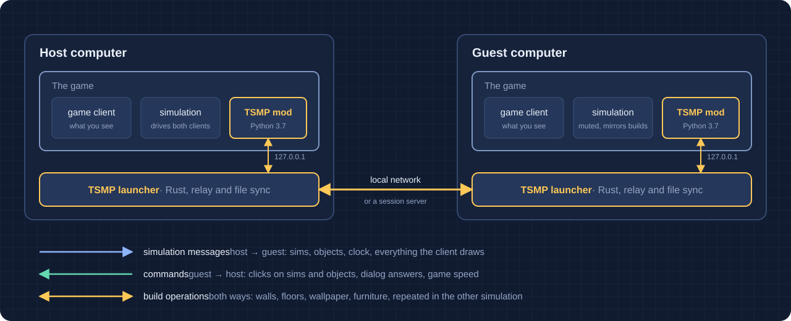

  

  <a href="README.md">English</a> | <b>Русский</b>

  
  
  
  

# TSMP

Мультиплеер с открытым кодом для The Sims 4. Два человека в одной локальной
сети играют одной семьёй на одном участке, а настройку берёт на себя лаунчер:
находит второй компьютер, копирует моды и сохранение и запускает обе игры с
теми дополнениями, которые есть у обоих.

## Что работает

  

Проверено на двух компьютерах с двумя копиями игры:

- **Режим жизни.** Оба игрока видят один участок, одних симов и одни часы.
  Каждый управляет симами, а что произойдёт, решает симуляция хоста.
- **Строительство одновременно.** Стены, полы и покрытия стен, которые рисует
  один игрок, появляются у второго, пока тот тоже строит.
- **Разные дополнения.** Игроки с разным набором DLC играют с общими для них
  дополнениями через штатный параметр игры `-disablepacks:`. TSMP ничего не
  разблокирует.
- **Настройка одной кнопкой.** Папка Mods и общее сохранение гостя становятся
  такими же, как у хоста. Ничего не удаляется: заменённые файлы уходят в
  папку с резервной копией.
- **Один журнал на две игры.** Каждый мод отправляет строки своего журнала
  второй стороне, а лаунчер показывает последние под статусом сессии.

Пока не сделано: переезд на другой участок, вход
гостя после того, как хост снял паузу, редактор создания персонажа. В режиме
строительства мебель и деньги семьи ещё не проверены на двойной учёт.

## Как это устроено

  

Игра уже разделена на клиент и симуляцию, которые обмениваются сообщениями.
Мод TSMP стоит на этой границе. У хоста он копирует то, что симуляция
сообщает клиенту, и отправляет гостю, а клиент гостя это рисует. То, что
нажимает гость, уходит обратно и выполняется симуляцией хоста.

Режим строительства не проходит через Python игры, поэтому мод записывает
каждую строительную операцию там, где клиент передаёт её симуляции, и
повторяет её во второй игре. Нужные для этого адреса меняются от сборки к
сборке; на незнакомой сборке эта часть сама отключается, а остальное
продолжает работать.

Сам мод тонкий. Поиск в сети, передача файлов и связь между компьютерами
живут в лаунчере. Подробности и то, как каждая из них была найдена, описаны в
[docs/internals.md](docs/internals.md) (на английском).

## Как играть

<table>
  <tr>
    <td width="50%"></td>
    <td width="50%"></td>
  </tr>
  <tr>
    <td valign="top"><b>Один из вас — хост.</b> Его сохранение и его моды становятся общими. Он открывает дверь.</td>
    <td valign="top"><b>Второй подключается.</b> Лаунчер сам находит хоста в домашней сети и копирует всё нужное. Он заходит в гости.</td>
  </tr>
</table>

Нужны два компьютера с Windows в одной локальной сети, на каждом своя копия
игры одной и той же версии, и в настройках игры должны быть включены
скриптовые моды.

1. Соберите лаунчер и мод (см. [Сборка](#сборка)) или возьмите готовые у
   того, кто собрал. Скопируйте `tsmp.ts4script` в папку `Mods` хоста.
   Сначала уберите другие моды для мультиплеера: они меняют те же функции.
2. Оба игрока запускают `tsmp.exe`. Windows один раз спросит, разрешить ли
   ему доступ через брандмауэр: разрешите для частных сетей, иначе хост не
   будет найден.
3. Один игрок выбирает **Создать сессию** и сохранение, которым поделится.
4. Второй выбирает **Войти в сессию**, находит хоста в списке, читает, что
   изменится, и нажимает **Синхронизировать**.
5. Оба нажимают **Запустить игру** и загружают общее сохранение.
6. Хост ставит паузу, как только участок загрузится, и ждёт, пока лаунчер не
   напишет **Сессия идёт. Обе игры соединены.**

Не закрывайте лаунчер во время игры: сессия идёт через него.

> [!WARNING]
> При подключении скриптовые моды хоста запускаются на вашем компьютере.
> Скриптовый мод может делать что угодно. Подключайтесь только к тем, кому
> доверяете.

Полезно знать:

- Файлы, которых нет у хоста, и ваши версии, которые отличаются, переносятся
  в `Mods.tsmp-backup/<дата>/` рядом с папкой Mods. Сохранения так же уходят
  в `saves.tsmp-backup/`.
- Копия из Steam запускается через Steam, и он может попросить подтвердить
  параметры запуска.
- После запуска игры лаунчер читает отчёт мода и предупреждает, если игра
  загрузила дополнения, которых в сессии быть не должно.
- `tsmp.status` в консоли читов показывает состояние сессии изнутри игры.
  В `<папка пользователя>/tsmp/tsmp.log` записано, что происходило в обеих
  играх.
- Синхронизация строительства включена по умолчанию. Чтобы выключить её,
  запишите `{"native": false}` в `<папка пользователя>/tsmp/config.json`.

## Версии игры и ветки

Каждая ветка репозитория названа по версии игры, на которой код собран и
проверен. Сейчас это **`1.129.39.1030`**.

Обновление игры само по себе новой ветки не создаёт. Новая ветка появляется
только тогда, когда обновление ломает мод; до тех пор используйте текущую.
Скорее всего сломается синхронизация строительства, потому что она зависит
от адресов внутри `Simulation_x64.dll`. Перед тем как что-либо трогать, мод
проверяет сборку и незнакомую оставляет в покое.

Эти адреса — данные, а не код: один файл на версию игры в папке
[`mappings/`](mappings). В лаунчер встроены файлы, известные на момент сборки.
Если для установленной версии игры файла нет, лаунчер запрашивает
`mappings/<версия>.json` из этого репозитория, поэтому после обновления игры
достаточно добавить сюда новый файл с найденными адресами. На главном экране
написано, готова ли совместная стройка для установленной версии. В файле
указаны сборка, которую он описывает, и функция, на которую должен указывать
каждый перехватываемый слот; мод сверяет и то, и другое с запущенной игрой,
прежде чем чем-либо пользоваться.

## Обновления

При запуске лаунчер спрашивает у GitHub последний релиз этого репозитория.
Более новый `tsmp.exe` скачивается, сверяется с контрольной суммой, которую
публикует GitHub, и встаёт на место запущенного файла; после этого в верхней
полосе появляется кнопка перезапуска. Мод находится внутри лаунчера и
обновляется тем же шагом. В запросах есть только название и версия программы
и ничего о вас или вашем компьютере. Чтобы выключить обновления, задайте
переменную окружения `TSMP_NO_UPDATE`.

Релиз создаётся отправкой тега `v<версия>`, совпадающего с версией в
`crates/tsmp-launcher/Cargo.toml`; его собирает и публикует
`.github/workflows/release.yml`.

## Сборка

    cargo test                               # всё, кроме самого интерфейса
    cargo build --release -p tsmp-launcher   # -> target/release/tsmp.exe
    cargo run -p tsmp-cli -- info            # показать найденную игру и дополнения
    cargo build -p tsmp-net --example live_pair   # тесты мода смогут использовать настоящий ретранслятор
    python -m unittest discover -s mod/tests
    python mod/build.py                      # -> dist/tsmp.ts4script

Для `mod/build.py` нужен интерпретатор Python 3.7, потому что игра загружает
только байт-код 3.7. Распакуйте официальный встраиваемый архив Python 3.7 в
`.tools/python37/` или передайте `--python37 <exe>`.

## Что лежит в репозитории

| Путь | Что это |
| --- | --- |
| `mod/` | Скриптовый мод (Python 3.7): перехваты, связь с лаунчером, правила сессии, синхронизация строительства |
| `crates/tsmp-core` | Находит игру, вычисляет общие дополнения двух игроков, строит и сравнивает списки файлов папки Mods |
| `crates/tsmp-net` | Поиск в локальной сети, протокол между лаунчерами для модов и сохранений, ретранслятор между двумя играми |
| `crates/tsmp-launcher` | Лаунчер (Rust + [gpui](https://www.gpui.rs)) |
| `crates/tsmp-cli` | Диагностическая командная строка поверх ядра |
| `mappings/` | Адреса внутри библиотеки симуляции игры, один файл на версию игры |
| `docs/internals.md` | Что известно о внутреннем устройстве игры и как это выяснено |

## Переводы

Лаунчер говорит на десяти языках: Deutsch, English, Español, Français,
Italiano, Polski, Português (Brasil), Русский, Українська и 简体中文. Он
запускается на языке системы и запоминает язык, выбранный в списке в верхней
полосе.

Каждый язык — один файл [Fluent](https://projectfluent.org) в
`crates/tsmp-launcher/locales/`, названный кодом языка (`de.ftl`,
`pt-BR.ftl`). Файлы встроены в exe, и больше они нигде не перечислены:
добавили файл — добавили язык.

Чтобы добавить или исправить перевод:

1. Скопируйте `en.ftl` в `<код>.ftl` и переведите текст после каждого `=`.
   Имена сообщений и `{ $переменные }` оставьте как есть. `language-name` —
   название языка на нём самом, как в списке.
2. Дайте сообщениям с числами те формы множественного числа, которые есть в
   языке (в `ru.ftl` их три).
3. Запустите `cargo test -p tsmp-launcher`. Тест не пройдёт, если не хватает
   сообщения или переменной или сообщение не удаётся отформатировать.

Чтобы попробовать файл без пересборки, положите его в папку `locales` рядом
с `tsmp.exe`: файлы оттуда заменяют встроенные. Сообщение, которого нет в
языке, показывается по-английски.

Большинство переводов ещё не проверено носителями языка, и названия пунктов
меню самой игры в них могут отличаться от настоящих. Исправления
приветствуются.

## Участие

Сообщения об ошибках и пул-реквесты приветствуются. Два правила, благодаря
которым проект можно публиковать:

- Никакого кода и ресурсов игры в репозитории. Находки об игре попадают в
  `docs/internals.md` в виде описаний, с тем, как их воспроизвести.
- Ничего, что открывает контент, которого у игрока нет.

## Лицензия

[MIT](LICENSE). Проект не связан с Electronic Arts и не одобрен ею. The Sims
— товарный знак Electronic Arts Inc.

В лаунчер встроены шрифты Golos Text и Unbounded по лицензии SIL Open Font
License; тексты лицензии лежат в `crates/tsmp-launcher/assets/fonts/`.
